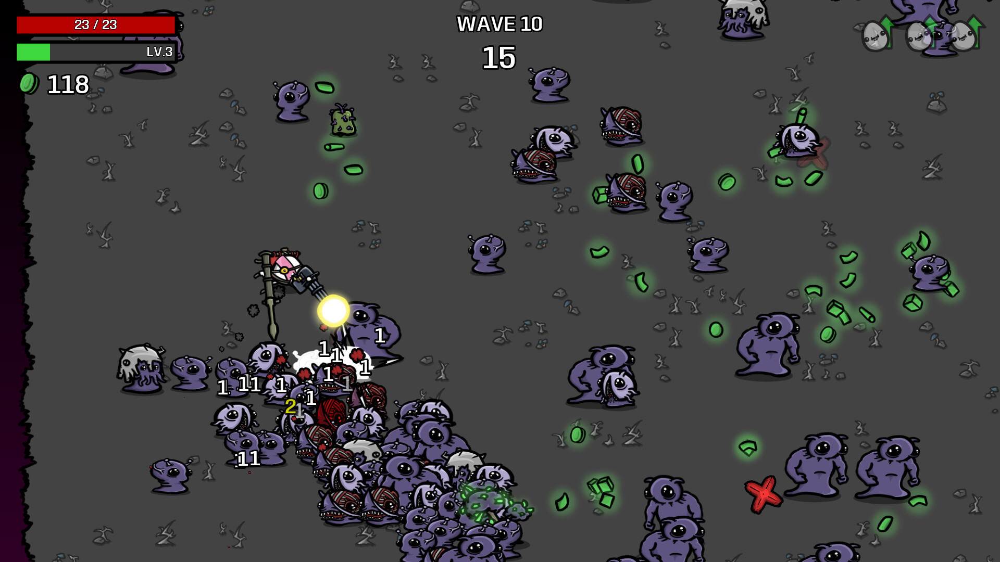
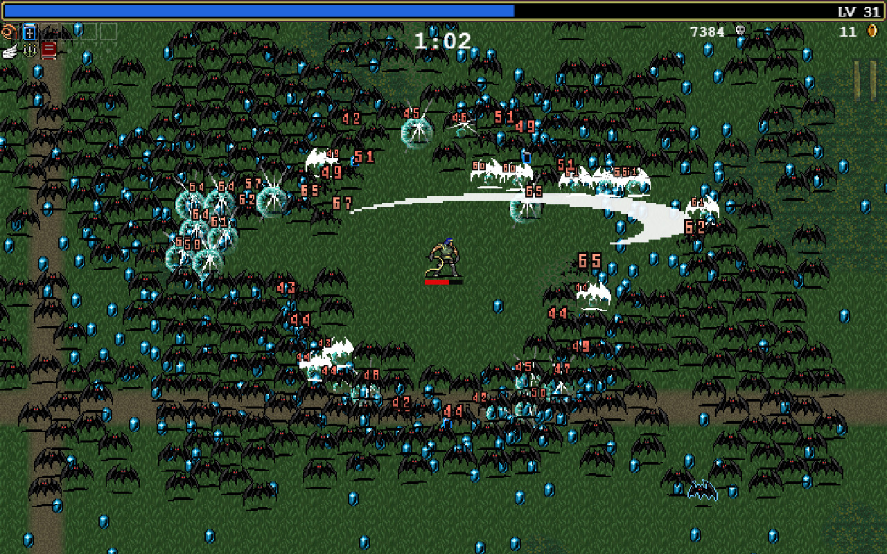
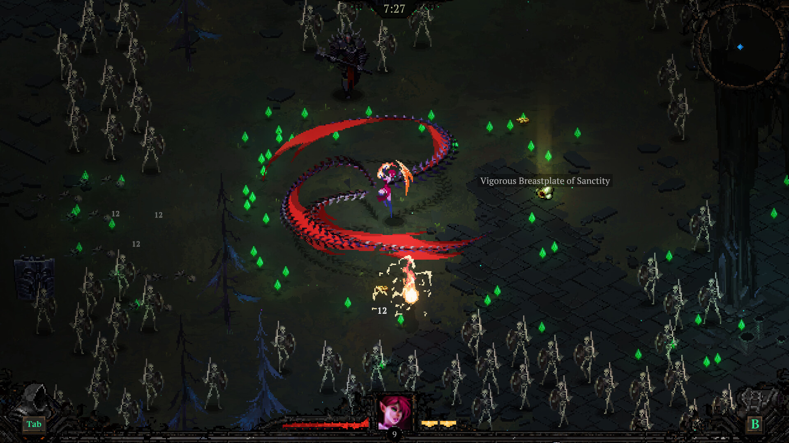
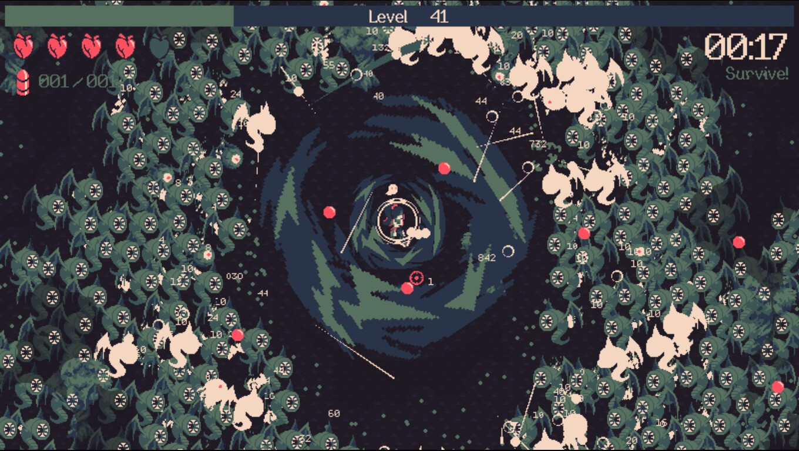
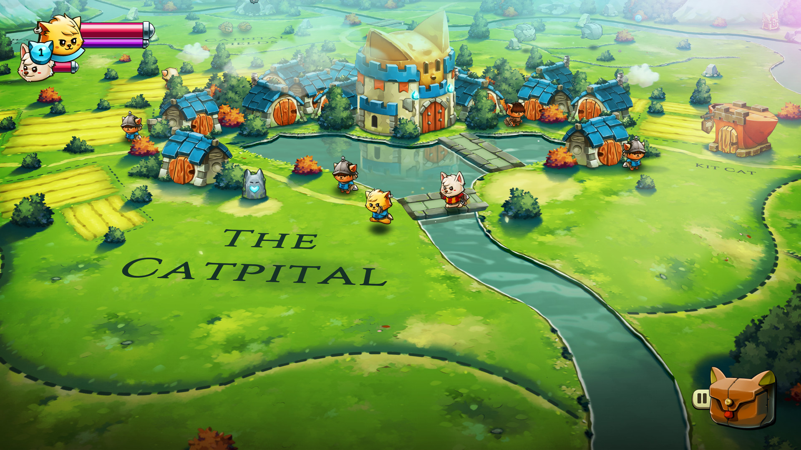
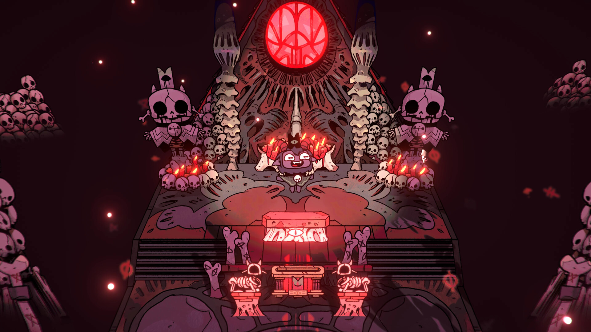
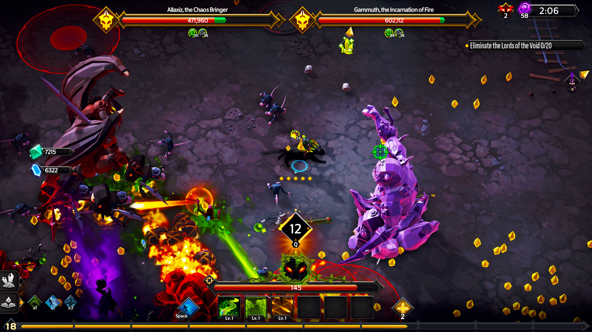
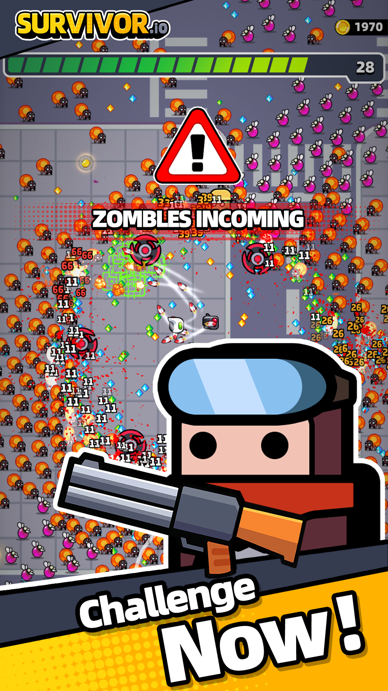
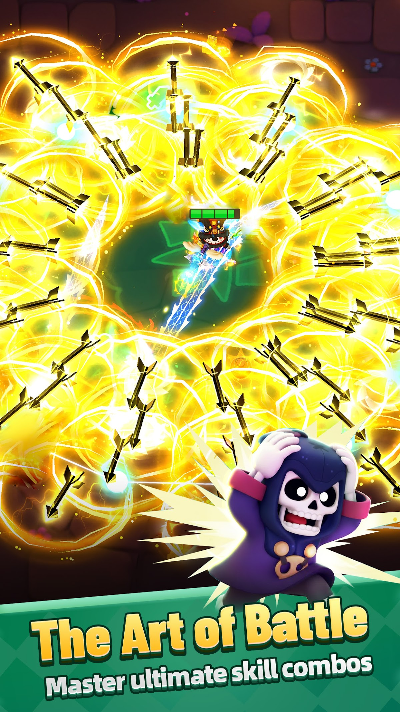
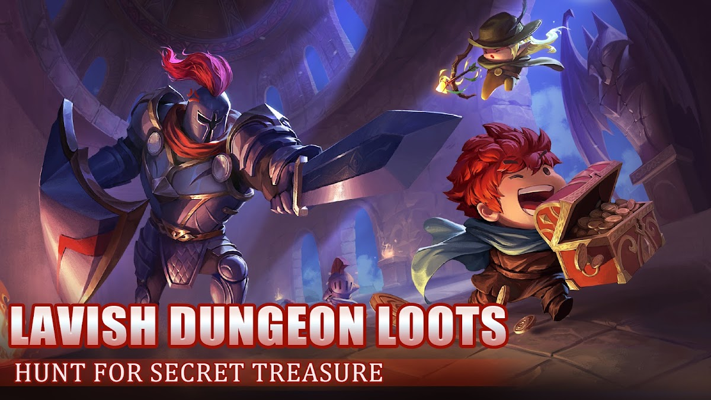

调研日期：2026-11-14。用途：为《萌爪骑士团》选择局内美术方向；本次不改动既有美术规格。

本轮收集了10款游戏的官方商店素材：7款Steam截图、3款Google Play宣传图。来源和图片原始地址保存在[sources.json](sources.json)。以下风格命名为观察归纳，优缺点和项目适配度为设计判断；没有将销量、评分或下载量当作美术效果的因果证据，也没有这些游戏的实际美术预算。

**先区分表现方法与美术气质。** 像素、非像素2D、风格化3D属于表现方法；明亮、暗黑、萌系、中世纪、绘本属于可叠加的气质。低多边形属于造型与渲染取向，有限色板属于色彩策略。下列分类用于选型比较，不是互斥且穷尽的艺术分类。

**参考范围。** 《弹壳特攻队》《土豆兄弟》《吸血鬼幸存者》《Death Must Die》《Soulstone Survivors》主要参考自动攻击、密集战斗的信息分层。《弓箭传说2》《元气骑士》《黎明前20分钟》是相邻动作肉鸽案例，操作与镜头不能直接照搬。《猫咪斗恶龙2》《咩咩启示录》是造型及视觉语言参考，不视为相同玩法。

| 方向与代表 | 可观察的视觉特征 | 优点（设计判断） | 缺点及成本（设计判断） | 对本项目的适配 |
|---|---|---|---|---|
| 简洁像素：《元气骑士》《吸血鬼幸存者》 | 像素轮廓、模块地面、小型角色、大量重复敌人；两款气质不同 | 轮廓可高度概括，素材易模块化；少帧动作也能成立 | 小角色脸部和饰品承载有限；转向和动画需要逐像素校正；复杂地面仍会造成噪声 | 可作为低细节像素方案；保留兔耳、猫耳、盾形等识别点 |
| 精细像素奇幻：《Death Must Die》 | 更细的材质与明暗、暗色环境、亮色攻击、精细角色表现 | 场景氛围与武器质感更强，适合强调骑士冒险 | 逐帧与方向成本上升；缩小后细节容易失效；背景纹理与敌人容易争夺注意 | 有条件适配；可借材质层级，不必采用暗黑配色 |
| 扁平粗描边卡通：《土豆兄弟》《弹壳特攻队》 | 大色块、明显外轮廓、简化面部与地形，攻击使用高亮色 | 对密集战斗友好；动物种类可通过大轮廓表达；控制细节后便于扩展素材 | 容易显得普通或廉价；“可爱”依赖比例、表情与动画，不能仅靠圆头；大量特效仍会遮挡 | 高适配；适合作为较克制的生产基线 |
| 非像素插画／绘本卡通：《猫咪斗恶龙2》《咩咩启示录》 | 平滑轮廓、动物表情、统一的绘画语言；前者明亮童话，后者黑色幽默 | 更能表达动物骑士性格；头像、卡图、场景容易建立一致世界观 | 画风一致性要求高；逐帧昂贵、骨骼动画也需要拆件和补画；精美背景可能干扰战斗 | 高适配；建议少量阴影、大块色面、低细节战场，不复制参考游戏的场景密度 |
| 圆润玩具感3D：《弓箭传说2》 | 圆润体块、模型光影、立体装备与鲜明技能效果 | 转向和动作连续；模型可用于局外展示；同骨架下可复用动画 | 前期需要建模、绑定、材质与灯光规范；皮肤也有制作成本；透明特效、阴影和同屏数量需要真机验证 | 有3D资产和技术能力时考虑；相对现有2D基线有额外转换成本 |
| 棱面低多边形3D：《Soulstone Survivors》 | 可见硬边体块、粗犷武器、夸张体积、高饱和法术 | 装甲、武器和Boss体积感强；简化材质可形成统一风格 | 低面数不等于低总成本；绑定和动作仍需制作；大量实体及特效可能遮挡地面；动物脸更容易僵硬 | 中等适配；适合更偏战斗的定位，萌宠亲和力需要单独验证 |

**有限色板是值得借鉴的策略，不必单独选一种技术。** 《黎明前20分钟》的参考截图主要用深蓝、灰绿、浅米色和红色组织敌人、攻击与危险。少色可以形成鲜明身份，但也会压缩四角色、敌我技能和不同状态的色彩空间；要补充形状、边界、纹理等提示。本项目可以采用“场景克制、角色与预警重点突出”，不必采用它的恐怖气质。

**对《萌爪骑士团》的初步建议。** 下一轮优先比较“简洁Q版像素”和“非像素粗描边轻绘本”两张相同构图的战斗样板。前者延续现有制作基线；后者更值得检验动物表情与亲和力。两张使用同一猫剑士、同一庭院、相同敌人数量、相同技能与预警，按同一720×1280画布和角色占屏比例比较。不要用大幅插画与低细节游戏截图做不公平比较。

评价重点是：缩到手机观看尺寸后能否认出四种动物；忙碌战斗中是否能立刻找到自己、敌人和安全区域；移动、转向、攻击是否能稳定批量制作；头像、角色与技能图标是否仍属于同一种画风。静态样板只能确认视觉方向，不能代替操作与性能验证。

**容易忽略的成本与偏差。**

- 像素不天然便宜、3D不天然更贵。成本取决于团队已有能力、方向数量、动作数量、角色差异、换装需求和质量目标。不能只比较一张立绘的制作时间。
- 四个角色不等于四份单张立绘：本项目还有方向、移动攻击分层、武器挂点、敌人、Boss和多类技能特效；换画风会影响整套资产规范。
- 同一款游戏不同阶段的截图可能完全不同。早期稀疏画面无法证明后期高密度战斗仍清晰；商店宣传图也不能作为真实UI尺寸和性能证据。
- 动物角色在立绘中可爱，不代表缩小后仍可辨。蝴蝶结、皮肤褶皱、甲片等应服从轮廓优先级，不应全部等量绘制。
- 敌方危险不能只依靠红色，需结合完整边缘和纹理；友方火焰、暴击字、红色装饰不能夺走同一视觉信号。
- 上一轮生成图可作为配色与气氛草案；其像素网格、屏幕比例、角色尺度和触控区尚未按制作规格验证，不作为最终资产标准。

**参考图与出处。** 以下均保留原图。Steam图为商店截图，但画面阶段各异；Google Play图含营销加工，已逐项标明。素材仅用于研究比较，不属于本项目可直接使用的游戏资产。

《土豆兄弟》：战斗截图。观察粗描边、低干扰地面和拾取物突出程度。[官方商店](https://store.steampowered.com/app/1942280/)

《吸血鬼幸存者》：战斗截图。观察小角色与大量敌人的尺度关系；此画面地面纹理也提醒我们，像素并不自动保证清晰。[官方商店](https://store.steampowered.com/app/1794680/)

《Death Must Die》：战斗截图。观察精细像素、暗色场景与亮色攻击的对比，也注意暗色敌人与背景的接近程度。[官方商店](https://store.steampowered.com/app/2334730/)

《黎明前20分钟》：高密度战斗截图。观察有限色板及红色投射物；不能由一张截图推断全流程清晰度。[官方商店](https://store.steampowered.com/app/1966900/)

《猫咪斗恶龙2》：探索截图，不是高密度战斗。观察猫狗形象、明亮童话场景与头像的一致性。[官方商店](https://store.steampowered.com/app/914710/)

《咩咩启示录》：仪式展示画面，不作为战斗HUD依据。观察动物角色、手绘轮廓和场景气质统一性。[官方商店](https://store.steampowered.com/app/1313140/)

《Soulstone Survivors》：战斗截图。观察棱面模型、体积感与大体积特效对地面信息的遮挡。[官方商店](https://store.steampowered.com/app/2066020/)

《弹壳特攻队》：带立绘、标志和文案的商店宣传图。可观察扁平造型语言；不可当作原始战斗截图或准确UI布局。[Google Play](https://play.google.com/store/apps/details?id=com.dxx.firenow)

《弓箭传说2》：带立绘和文案的商店宣传图。可观察圆润立体造型；不以满屏技能夸张展示作为正常战斗的清晰度标准。[Google Play](https://play.google.com/store/apps/details?id=com.xq.archeroii)

《元气骑士》：本次下载的是宣传插画，不是像素实机画面，不用于判断局内像素细节。其局内2D像素定位另由官方商店说明核实；若进入像素方案制作，应补充同尺度实机参考。[Google Play](https://play.google.com/store/apps/details?id=com.ChillyRoom.DungeonShooter)

