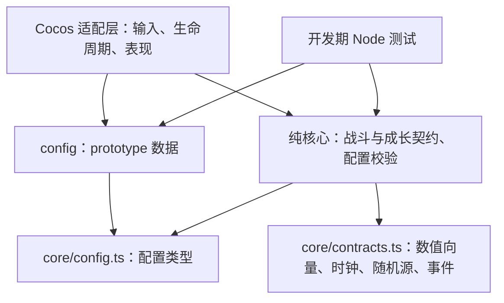

# Pawvalor 阶段 1：核心依赖与规则交接

本文件依据[原始设计基线](pawvalor-v0.1-original.md)和[已批准的阶段 1 设计](../superpowers/specs/2026-10-15-phase-1-design.md)。阶段 1 提供纯 TypeScript 契约、配置结构、引用校验和雷恩测试数据；下面的升级事务、伤害处理和清理顺序是后续实现约束，不代表已有状态机或战斗系统。

雷恩示例位于 `client/assets/scripts/config/raine.prototype.ts`，导出 `rainePrototypeConfig: GameConfig`。根字段 `calibration: 'prototype'` 覆盖整张表的所有嵌套数值，包括基础属性、武器、弹道、权重、倍率、冷却和触发次数。测试参数尚未经过平衡、性能或真机验证。三条路线及六个分支只有数据与符号行为引用，**尚无实际战斗行为**。

## 依赖方向与职责

依赖箭头指向被依赖方。`core/` 只能引用核心内部模块；`config/` 可引用核心类型和其他配置。核心与配置均不得依赖 `cc`、微信 API、DOM、Node 专用 API 或适配层。测试位于 `client/tests/`，由独立测试编译生成 `client/.test-build/`；Node 是开发期执行环境。配置为可序列化数据，不含回调或执行器；行为 ID 供未来执行器识别，不是动态脚本。

| 边界 | 负责内容 | 后续实现约束 |
|---|---|---|
| 单局流程 | 开始、暂停、恢复、结束及重置 | 注入时钟与随机源；暂停不推进模拟时间 |
| 战斗核心 | 目标快照、攻击请求、命中与伤害事件 | 使用数值向量和带代次的实体句柄，不直接操作节点 |
| 成长核心 | 构筑状态、待升级队列与待选择项 | 合法性、抽取权重、固定进化和组合调度分别负责 |
| 配置校验 | ID、引用、归属、数值和固定节点约束 | 返回全部可检测问题及字段路径；有问题必须阻止启动 |
| Cocos 适配 | 引擎输入和帧更新转换为核心命令，核心事件转换为表现 | 仅适配层使用引擎 API；启动诊断不等于战斗已实现 |

客户端工程、资源、测试及工具配置统一放在 `client/`；Creator 保持 3.8.6，编辑器打开 `client/`。`server/` 仅预留，不定义服务端协议。公共文档位于仓库根目录 `docs/`。2026-10-18 按用户更正，Git 根目录为 `PawValor/`，上述目录均纳入同一仓库。

## 雷恩结构与数值含义

唯一英雄雷恩绑定唯一长剑；长剑基础攻击引用直线剑气，保留单英雄远程自动攻击方向。当前数据没有实现移动、索敌、发射、碰撞或伤害计算。

| Lv.3 主路线 | Lv.7 两种分支 | Lv.11 自动终极 | 分支符号行为规划 |
|---|---|---|---|
| 万剑流 | 散华 / 聚锋 | 万剑归宗 | 扇形剑阵 / 集中剑阵 |
| 雷霆流 | 连锁雷击 / 雷霆贯心 | 雷神审判 | 连锁审判 / 贯穿审判 |
| 回旋剑流 | 护体飞剑 / 追魂剑 | 无尽剑轮 | 护体剑轮 / 追踪剑轮 |

主路线锁定终极类型，分支引用各自的 `ultimate-behavior` 效果，以 `planned-` 开头的 `behaviorId` 表示未来差异。路线终极效果与分支行为是同一次终极进化的基础配置与具体解释，未来执行器不得无条件当作两份独立攻击重复结算。运动控制器由每个弹道的单一 `movement` 指定；连锁、范围等攻击模式不授权给同一实体同时安装多种运动控制器。

十二项通用天赋逐项保留原始设计第 6 节初始测试值：

| 天赋 | 每级效果 | 上限 | 配置表达 |
|---|---|---|---|
| 攻击强化 | 攻击伤害 +10% | 5 | attackDamage / multiply / 1.10 |
| 迅捷攻击 | 攻速 +8% | 5 | attackSpeed / multiply / 1.08 |
| 精准暴击 | 暴击率 +5 个百分点 | 4 | critChance / add / 0.05 |
| 致命一击 | 暴击伤害加成 +20 个百分点 | 3 | critDamageMultiplier / add / 0.20 |
| 穿透强化 | 适用弹道穿透 +1 | 2 | pierceCount / add / 1 |
| 弹道扩大 | 弹道范围 +10% | 3 | projectileSize / multiply / 1.10 |
| 射程提升 | 射程 +12% | 3 | range / multiply / 1.12 |
| 范围增幅 | 技能范围 +10% | 3 | areaSize / multiply / 1.10 |
| 生命强化 | 最大生命 +12% | 3 | maxHealth / multiply / 1.12 |
| 轻盈步伐 | 移速 +6% | 3 | moveSpeed / multiply / 1.06 |
| 坚韧护甲 | 受到伤害 -6% | 3 | damageReduction / add / 0.06 |
| 额外弹体 | 增加一个削弱后的攻击弹体 | 1 | 独立 single 模式，数量 1，测试伤害倍率 0.6 |

这张原型表中，通用天赋的 `multiply` 值表示每级相对未修饰基础值的倍率：等级为 `rank`、每级参数为 `factor` 时，结果为 `baseline * (1 + rank * (factor - 1))`。例如攻击强化满级为基础攻击伤害的 1.50 倍，攻速满级为基础攻速的 1.40 倍；不按 `factor ** rank` 复利。攻速修饰作用于每秒攻击频率，实际攻击间隔应为基础间隔除以攻速倍率。

`add` 的结果为 `baseline + rank * value`，概率及伤害倍率的百分点直接相加。精准暴击满级增加 20 个百分点；致命一击满级增加 60 个百分点，例如基础暴击倍率 1.5 变为 2.1。坚韧护甲增加的是减伤比例：零基础减伤下每级增加 0.06，三级总减伤 0.18，受到伤害为原来的 0.82 倍。额外弹体的 0.6 仅修饰额外那次攻击，不能削弱整把武器；该天赋既不替换基础攻击，也不递归生成更多额外弹体。上述计算语义约束未来实现，阶段 1 未提供计算器；不同来源之间的合并顺序、概率钳制、回血和尺寸单位解释仍需后续明确。

## 升级事务与多级经验

每次升级严格串行处理一个目标等级：

1. 进入升级事务，将当前目标等级置为待处理状态；战斗暂停时模拟时钟停止。
2. 激活之前等级已经排队、且 `activateAtLevel` 等于当前目标等级的组合；先移入 active 集合以防重复执行。
3. 按目标等级处理成长。Lv.3 从英雄的三条路线中选一并锁定；Lv.7 仅在当前路线的两个分支中选一；Lv.11 自动授予当前路线终极及所选分支行为。其余等级进入普通三选一。
4. 等待当前选择提交后重算构筑；Lv.11 无选择，但同样提交终极变化并重算。普通卡先过滤不合法、满级、互斥或不满足前置的候选，再按权重不放回抽样。
5. 检查当前构筑新满足的组合，记录 `eligibleAtLevel = 当前等级`、`activateAtLevel = 当前等级 + 1`；同时排除 pending 与 active 中已有 ID。
6. 关闭本次事务，才允许处理下一个待升级等级。取消重复提交，不允许同时挂起两个选择。

组合免费激活，不占普通三选一机会；本级新满足的组合不得当级激活。已有组合激活后即使满足另一组合前置，也在本次最终检查排到下一级，禁止在本级递归激活。Lv.11 自动进化不能跳过组合检查。

一次经验奖励可产生多个目标等级：按升序加入 `GrowthState.pendingTargetLevels`，逐级处理；有 `pendingChoice` 时必须等待提交。例如从 Lv.2 获得足够经验到 Lv.8，应先处理 Lv.3 路线选择，然后逐级处理 Lv.4、5、6，再等待 Lv.7 分支选择，最后处理 Lv.8。不能只按最终等级执行一次普通抽卡。每局免费刷新为 2 次，Lv.3/7/11 固定节点不刷新、不消耗普通刷新次数。

测试组合 `test-thunder-sword-rain` 明确标记 `usage: 'test-only'`，要求雷恩、万剑流、雷电附魔至少 1 级、攻击强化至少 2 级，并固定 `activation: 'next-level'`。这些前置、四枚弹体及倍率是结构演示，未锁定正式「雷霆剑雨」设计，也没有实现激活调度。

## 元素策略与伤害衍生边界

火、冰、雷各有附魔效果和共鸣效果引用。示例 `elementPolicy` 明确为 `test-only`：最多两个附魔、最多两个副机制，测试选择 `innateElementCounts: false`、`enchantmentsUseSecondarySlots: false`。这不是正式默认值。雷霆路线固有雷属性不被附魔覆盖；如果再配置火和冰，测试策略下将同时出现雷、火、冰三种属性来源，不能将其描述为“总共最多两种元素”。

相同属性应强化原效果形成共鸣，不应无条件叠一份重复命中触发；不同属性可增加额外命中效果。共鸣表仅给出引用，具体替换/增强、数值合并和槽位判断尚无执行器。配置校验通过不等于这些战斗约束已经运行。

直接攻击与所有衍生攻击必须携带相同 `rootAttackId`、各自 `sourceKind` 和 `depth`。直接攻击从深度 0 开始，每次衍生增加深度；split、bounce、explosion、element、damage-over-time 和 synergy 不能伪装成 direct 重置链路。未来执行器必须同时检查来源白名单、有限深度、每根攻击触发上限、模拟时间冷却及同目标命中间隔。

本表所有元素效果只允许 direct 来源；元素、持续伤害和其他衍生来源不得默认再次触发元素。连锁示例单独使用 `bounded-derived`，仅允许 direct/bounce、最大深度 2、每根攻击最多 3 次，并有 0.2 秒冷却和同目标间隔；这些原型参数不保证连锁算法或性能。运行时计数应按根攻击及策略/效果隔离，避免一个元素耗尽另一个元素的触发预算。分裂产生的实体不能无限再次分裂，反弹、爆炸或组合也不能绕过同一根攻击的限制。

主技能、追加弹体、领域与元素伤害只继承各自配置明确允许的属性、附魔与副机制；不得把主攻击的所有修饰自动复制到每个衍生效果。命中/击杀事件仍须检查实体句柄的 `id + generation`，防止延迟伤害命中被对象池复用后的其他实体。

## 多局重置与阶段 3 前决策

`reset()` 应清理模拟时钟、攻击 ID 与根触发计数、各效果/目标冷却、延迟任务、未提交选择、待升级等级队列、pending/active 组合、天赋等级、路线/分支、附魔/副机制状态、生命与临时状态。事件总线必须清空排队事件和订阅，外部监听器必须取消订阅；对象池回收节点与实体并更新代次，清理特效、输入和 HUD 引用。需要保证重复 reset 安全、重开局没有旧回调或旧计时继续执行。随机源应按未来确定的种子策略重新初始化，不能让跨局状态意外影响复现。以上是清理清单，当前没有生命周期实现。

阶段 3 接入真实构筑之前必须锁定：

- 主属性是否占两个附魔位之一；若不占位，是否接受三种属性来源以及相应触发与表现成本。
- 附魔是否占两个副机制槽；同属性共鸣如何计槽、强化、替换和拒绝第三附魔，副机制与附魔升级是否占新槽。
- 普通候选不足三张时的兜底奖励、数值、上限、满级后合法性与界面选择策略。不得复制卡、提供无效满级卡或突破已有十二天赋上限；建议独立且始终有效的基础属性奖励，但当前未添加伪造兜底天赋。
- 通用属性与其他来源的合并顺序、附加弹体适用范围、完整组合前置表和经验曲线。Lv.11 应在 Boss 前留出体验终极的时间；抽取相关性与权重调整不能绕过合法性过滤。

独立类型检查、边界检查与完整测试统一通过 `client/` 内的 `npm.cmd run verify` 运行。它验证纯核心和配置的结构及已声明数据规则；编辑器导入、场景预览、实际战斗体验与微信真机性能必须由各自阶段单独验证。
